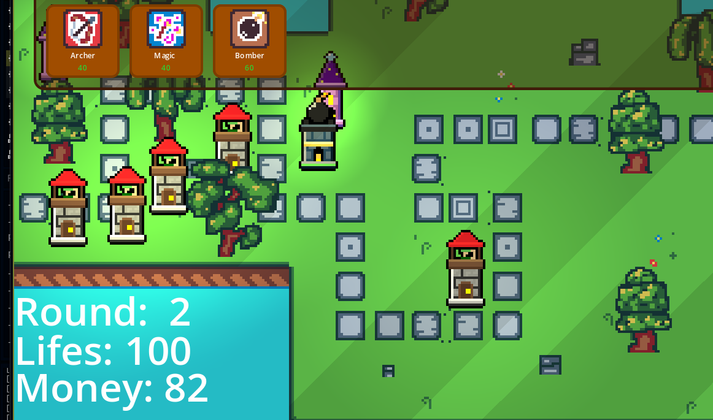

# TowerDefense
The final project for Hack Club Thirdspace! Play here: https://huntorbehunted83.itch.io/tower-defense



## About
This game was made by 2 hackclubers for the 8th and final week of Thirdspace.
It is a game about tower defense. It still very simple, with only 5 kinds of enemies and 3 types of towers, but all the hand-made art and the coding was made hardly in 20h for the last week.

## Rounds
The game works in rounds. Rounds are godot resources that simply contains all the data needed to spawn enemies with the right delay. It still a poor logic (only dicionaries on a way thaat enemies can just spawn with the saem type of enemy, as dictionaries don't allow duplicated keys)
There are 10 rounds, and at each round you receive a small amount of money. (defeating enemies also gives you money)

NOTE: You start a round pressing enter!

## Towers
There are 3 types of towers: 
- Archer: Simply throws arrows on the enemies
- Mage: Throuws a magic frost speel and slows down enemies
- Bomb: Throws a lot of damage on the enemies!!

## How to build
1. Clone the repo with
```git clone https://github.com/Renan-G-projec/TowerDefense.git```
2. Open in Godot and press the big run button!

## AI disclosure:
NONE AI was used on asset generation or anything like that.
A small amount of AI was used to point out bugs on the code, but none code was written or pasted by it.